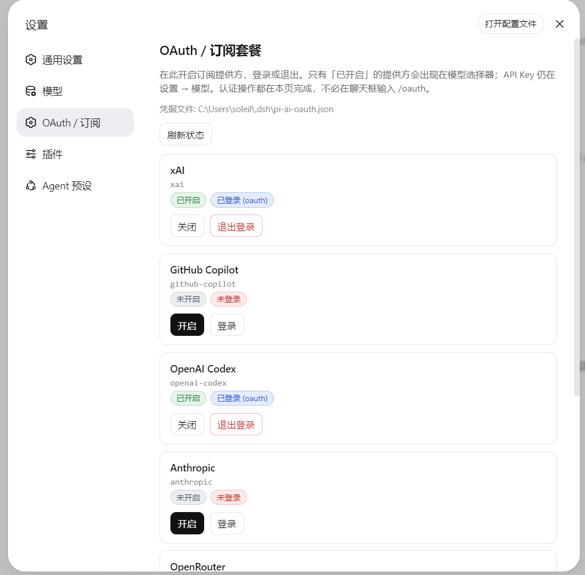
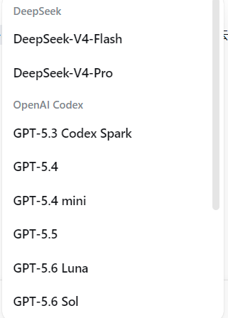
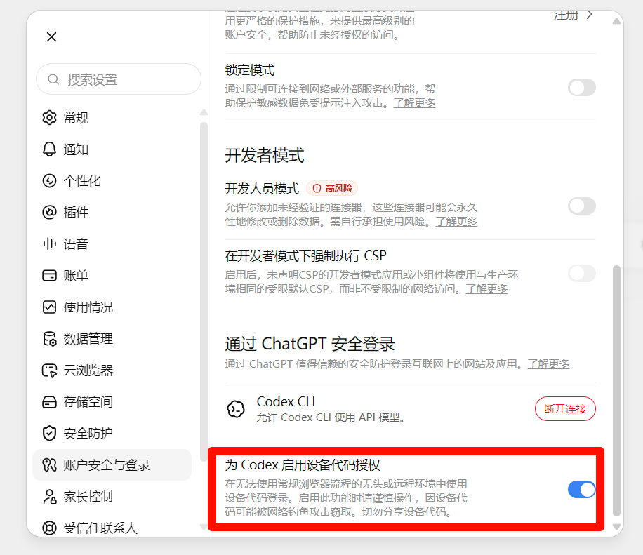

# dsh-llm-oauth

English | [中文](README.zh.md)

## Summary

Sign in to OAuth subscription providers and make their models available in [DeepSeek Harness](https://github.com/deepseek-ai/deepseek-harness). This fork includes the customized plugin source; the [portable Web setup](../README.md) installs its Host and Settings page without transferring tokens between machines.



Official `dsh-llm-pi-ai` authenticates with API keys only and never runs an OAuth login or refresh. This plugin reuses the same catalog package, [`@earendil-works/pi-ai`](https://www.npmjs.com/package/@earendil-works/pi-ai), but constructs `Models` with a durable `CredentialStore` so subscription tokens refresh on the request path.

Packaging follows the official plugin guides — [your first plugin](../../docs/user/develop/basic/index.md) and [publish / install](../../docs/user/develop/basic/publish.md):

- `package.json` → `dsh.bundle.patch` plus optional `dsh.client` (Web Settings face)
- `cordis.patch.yml` inserts one plugin row
- `prepare` bundles `src/` → `lib/` (including `lib/client.js`) on git install
- function plugin: export `name`, `inject`, `Config`, `apply` — **no `export default`**

## Table of Contents

- [Providers](#providers)
- [Enable vs sign-in](#enable-vs-sign-in)
- [Install](#install)
- [Settings → OAuth / Subscriptions](#settings--oauth--subscriptions)
- [ChatGPT / Codex: enable device-code auth first](#chatgpt--codex-enable-device-code-auth-first)
- [Login / commands](#login--commands)
- [Do not collide with llm-pi-ai](#do-not-collide-with-llm-pi-ai)
- [Develop](#develop)
- [Limits](#limits)
- [License](#license)
- [Dev Note](#dev-note)

<a id="providers"></a>
## Providers

| Subscription | Provider id | Notes |
|---|---|---|
| Grok (SuperGrok / X Premium) | `xai` | Model ids come from the installed pi-ai catalog. |
| GitHub Copilot | `github-copilot` | Optional Enterprise URL defaults to public `github.com`. |
| ChatGPT / Codex plan | `openai-codex` | **Not** the `openai` API-key route. Needs device-code authorization enabled in ChatGPT — see below. **Account-ban risk.** |
| Anthropic subscription | `anthropic` | |
| OpenRouter | `openrouter` | Large catalog — enable only if you need it. |
| Kimi For Coding | `kimi-coding` | |

GitHub Copilot models come directly from the authenticated `/models` endpoint for your account, using pi-ai's OAuth credentials and account URL, not a local shim. Each model listing and stream start refreshes discovery. Metadata resolution reuses that listing, or fetches it on first use, so opening the picker does not request a separate catalog for every model. Refreshes run sequentially with a 20-second deadline including queue time; there is no background polling or stale-catalog fallback. Authentication, network, and malformed-metadata failures invalidate the metadata cache and are reported; the next operation retries.

Copilot discovery includes chat models enabled for the picker, excludes disabled policies and models that explicitly lack tools or streaming, and uses the advertised input modalities, token limits, reasoning efforts, and supported HTTP endpoints. Individual accounts with no eligible picker rows may use explicitly enabled policies; other account types never use that fallback. pi-ai retains OAuth refresh and native Responses, Messages, or Chat Completions streaming, including installed model compatibility settings. Models absent from pi-ai's static catalog can therefore appear and run without hardcoded ids.

Other providers use the installed `@earendil-works/pi-ai` catalog. Bump that dependency and rebuild when you want a newer catalog for them.

Models whose catalog entry declares image input receive DSH durable image attachments. Text-only models reject images before the provider request.

<a id="enable-vs-sign-in"></a>
## Enable vs sign-in

After install the plugin is **dormant**: the catalog lists the providers above, but **`providers: {}`**, so the model picker is **not** flooded with hundreds of models.

| Concept | Meaning | How |
|---|---|---|
| **Enable** | Register the LLM route; provider appears in the picker | Settings → **OAuth / Subscriptions**, `/oauth enable xai`, or auto on login |
| **Sign in** | Store tokens in `pi-ai-oauth.json` | Settings panel, `/oauth login xai`, or `bin/login.mjs` |
| **Disable** | Remove from picker; **keep** stored tokens | Settings panel or `/oauth disable xai` |

Only **enabled** providers list models in the chat picker. OAuth enablement and sign-in belong to Settings → **OAuth / Subscriptions**; the first-party provider configuration directory remains unchanged.

<a id="install"></a>
## Install

Use this fork's current DSH checkout. Provider enablement uses Cordis volatile Config fields and persists in the active profile's `cordis.patch.yml`; changes update the adapter routes without restarting or changing saved sign-ins. Run the following from the DSH checkout after syncing:

```sh
pnpm run setup:web
```

Setup builds the local source and installs its bundle into the selected Web profile. Stop and restart that profile around setup; a browser refresh alone does not replace the running Host. Complete provider sign-in separately on each machine.

<a id="settings--oauth--subscriptions"></a>
## Settings → OAuth / Subscriptions

The Web UI adds a settings section (between **Models** and **Plugins**) with:

- Every catalog subscription provider
- Badges: enabled / disabled, signed-in / out, login-in-progress
- Actions: enable, disable, sign in, sign out (buttons on this page — no need to type `/oauth` in chat)
- Successful sign-in stores tokens and auto-enables the provider
- Device codes show on the page (with copy); authorization URLs open in a new tab, or via **Open authorization page** if the popup is blocked

Providers that ask “pick a login method” (e.g. `openai-codex`) auto-select **device code** on Web (browser login needs a local `:1455` callback). If you still see an interactive-prompt error, use `bin/login.mjs` in a terminal.

After a provider is enabled and signed in, its models appear in the chat picker. Settings → **Models** continues to configure first-party API-key routes:



API-key providers stay curated under **Settings → Models**. OAuth enable + login live on this plugin’s page.

Host HTTP API (same-origin Web):

| Method | Path | Body |
|---|---|---|
| `GET` | `/dsh-llm-oauth/status` | — |
| `POST` | `/dsh-llm-oauth/enable` | `{ "provider": "xai" }` |
| `POST` | `/dsh-llm-oauth/disable` | `{ "provider": "xai" }` |
| `POST` | `/dsh-llm-oauth/login` | `{ "provider": "xai" }` |
| `POST` | `/dsh-llm-oauth/logout` | `{ "provider": "xai" }` |

<a id="chatgpt--codex-enable-device-code-auth-first"></a>
## ChatGPT / Codex: enable device-code auth first

`openai-codex` on Web uses **device code**, not the localhost `:1455` browser callback. ChatGPT hides that flow until you turn it on:

1. Open [ChatGPT → Settings → Apps & connectors](https://chatgpt.com/) (or **Settings → Connectors / Codex**, depending on the current UI).
2. Find **Codex** and enable **Enable device code authorization for Codex**.
3. Come back here, click **Sign in** on `openai-codex`, then open the authorization URL and enter the code shown on the Settings page.



Without that toggle, the device page rejects the code even though this plugin already picked the device-code method.

**Risk:** signing in to Codex / ChatGPT this way (device code or any unofficial client OAuth) can get the ChatGPT account restricted or banned. OpenAI treats this as using the subscription outside official Codex / ChatGPT apps. Use a disposable account if you try it; do not put a main or paid account you cannot afford to lose on this route. This plugin cannot prevent or reverse a ban.

<a id="login--commands"></a>
## Login / commands

In the Web UI:

```
/oauth status
/oauth list
/oauth enable xai
/oauth login xai
/oauth disable xai
/oauth logout xai
```

`/oauth login` returns the authorization URL and user code immediately so the chat UI does not hang. Finish in the browser, then run `/oauth status` or refresh the Settings page. The poll continues in the background.

Credentials are stored at `$DSH_HOME/pi-ai-oauth.json` (default `~/.dsh/pi-ai-oauth.json`).

If you need a terminal (or a provider still requires an interactive prompt):

```sh
node bin/login.mjs --list
node bin/login.mjs xai
```

After a profile install:

```sh
node %USERPROFILE%\.dsh\profiles\web\node_modules\dsh-llm-oauth\bin\login.mjs xai
```

Or enable in the profile's `cordis.patch.yml` without the UI:

```yaml
- id: llm-oauth
  config:
    providers:
      xai: {}
```

<a id="do-not-collide-with-llm-pi-ai"></a>
## Do not collide with llm-pi-ai

`dsh-base` mounts dormant `dsh-llm-pi-ai`. Declaring the same provider id under an `llm-pi-ai:` settings section throws `DUPLICATE_ADAPTER`.

- Subscription / OAuth → this plugin only
- API keys (DeepSeek, official OpenAI API) → `llm-deepseek` / `llm-pi-ai`

<a id="develop"></a>
## Develop

```sh
pnpm install
pnpm test
pnpm run build
node bin/login.mjs --list
```

`@deepseek-ai/*` packages are peers supplied by the DSH profile. Configuration and Loader integration tests need the current DSH peers available locally; adapter tests mock the DSH LLM interface and exercise pi-ai against recorded-format HTTP responses without live model calls.

<a id="limits"></a>
## Limits

- Copilot discovery requires authentication and network access; other model lists follow `@earendil-works/pi-ai`. No private model table is maintained
- No full native replay signatures
- No in-browser OAuth callback server (device code / open URL)
- Plain OpenAI API and DeepSeek official stay on API keys
- Settings → **Models** curated editors still target API keys; OAuth enable + login live under **Settings → OAuth / Subscriptions**

<a id="license"></a>
## License

MIT

<a id="dev-note"></a>
## Dev Note

None.
